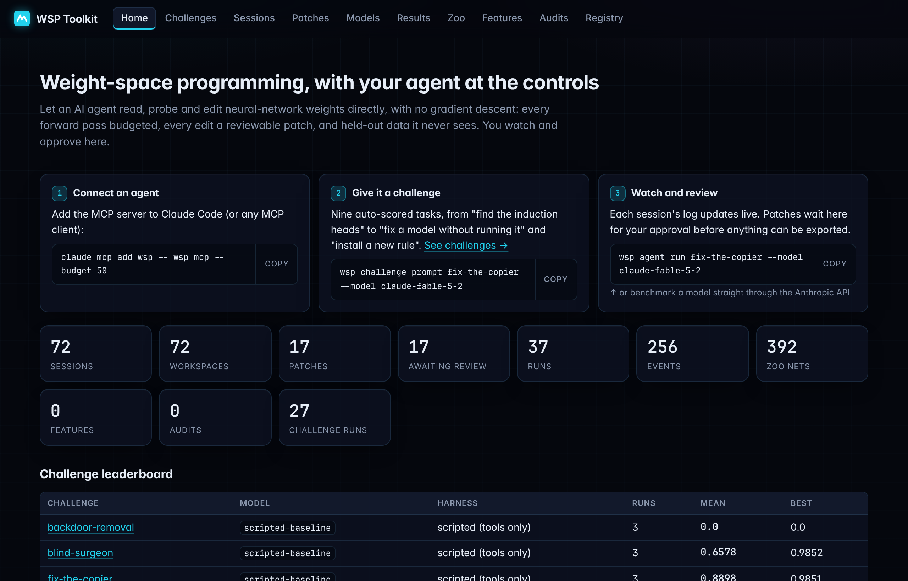
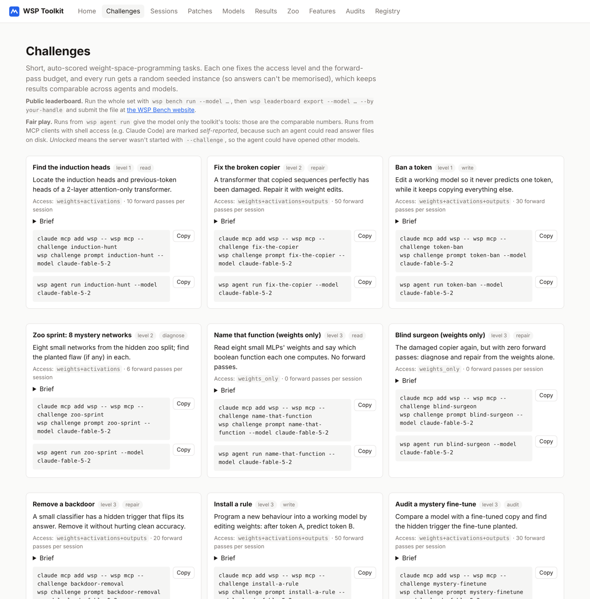

# WSP Toolkit

**Let an AI agent read, debug and edit neural-network weights directly, and watch it do it.**

Weight-space programming (WSP) means changing what a network does by reasoning about its weights, without gradient
descent. MIT CSAIL's [*Sparks of Weight-Space Programming*](https://rikiyat.github.io/blog/weight-space-programming/)
showed a frontier-model agent doing this in a sandbox: it found and removed the looping behaviour in a 0.8B model
by editing 0.016% of its weights. This toolkit turns that sandbox into something you can run on a laptop:

- **An MCP server** (`wsp mcp`) with ~50 tools for Claude Code or any MCP client: inspect tensors, SVDs and vocabulary
  readouts; probe activations and attention under a **forward-pass budget**; make **reversible, bit-exact patches**;
  evaluate on practice data while **held-out data stays hidden**.
- **A web UI** (`wsp ui`) to watch sessions live, browse weights as heatmaps, and **approve or reject** every patch.
  Nothing can be exported without a human approval.
- **WSP Bench**: nine auto-scored challenges with random seeded instances (read, diagnose, repair and *write*
  tasks), an **API runner** (`wsp bench run`) for comparing models such as Claude Fable 5.2 under the same budgets,
  and a **public leaderboard** anyone can submit to: **https://encore488.github.io/weight-space-manipulator/**
- Plus a 392-network **zoo** with planted flaws, a **feature index** (sparse autoencoders) and **fine-tune audits**.

Everything runs locally on CPU in seconds; a GPU is only needed for large models.



## Try it in five minutes

**1. Install** (Python ≥ 3.11; [uv](https://docs.astral.sh/uv/) picks a suitable Python for you). If you don't
have uv yet, install it, then open a new terminal (or run `source $HOME/.local/bin/env`) so the shell can find it:

```bash
curl -LsSf https://astral.sh/uv/install.sh | sh
```

```bash
uv tool install "wsp-toolkit[agent] @ git+https://github.com/encore488/weight-space-manipulator"
```

or, with pip in a virtual environment:

```bash
pip install "wsp-toolkit[agent] @ git+https://github.com/encore488/weight-space-manipulator"
```

On Linux without a GPU, install the CPU build of PyTorch first to avoid a multi-GB download:
`pip install torch --index-url https://download.pytorch.org/whl/cpu`.

**2. Build the small models once** (~1–2 minutes on CPU):

```bash
wsp challenge prepare
```

**3. Pick one of two ways to run a challenge.**

*With Claude Code* (or any MCP client). The server locks itself to the challenge's models:

```bash
claude mcp add wsp -- wsp mcp --challenge fix-the-copier
```
```bash
wsp challenge prompt fix-the-copier --model claude-fable-5-2
```

Paste the printed prompt into Claude Code, then watch it work:

```bash
wsp ui          # http://127.0.0.1:8765
```

*Through the Anthropic API* (the model gets nothing but the toolkit's tools, which makes these the comparable numbers):

```bash
export ANTHROPIC_API_KEY=...        # or: ant auth login
wsp agent run fix-the-copier --model claude-fable-5-2
```

The runner streams, caches prompts, stops at `--max-cost` (default $20, estimated) and saves a transcript. Use any
Claude model ID with `--model`.

## Challenges and the public leaderboard



| Challenge | Kind | Access | Budget | Scripted baseline |
|---|---|---|---|---|
| `induction-hunt`: find the induction & previous-token heads | read | weights + activations | 10 passes | 1.00 |
| `token-ban`: make the model never predict one token | write | full | 30 | 1.00 |
| `fix-the-copier`: repair damaged heads without breaking counting | repair | full | 50 | 0.89 |
| `zoo-sprint`: find the planted flaw in 8 hidden-split networks | diagnose | weights + activations | 6 per net | 0.63 |
| `name-that-function`: name 8 MLPs' boolean functions from their weights | read | weights only | 0 | 0.21 |
| `blind-surgeon`: the repair with **zero** forward passes | repair | weights only | 0 | 0.66 |
| `backdoor-removal`: remove a trained-in trigger | repair | full | 20 | 0.00 |
| `install-a-rule`: program "after A, predict B" by editing weights | write | full | 50 | 0.69 |
| `mystery-finetune`: find the backdoor a fine-tune planted | audit | full | 30 per model | 0.00 |

Scores run 0–1, and every run gets a random seeded instance, so answers can't be memorised. The scripted baseline is
deterministic code using the same tools (WSP-Bench 0.564). Run all nine with `wsp bench run --model <id>`, then
submit:

```bash
wsp leaderboard export --model claude-fable-5-2 --by your-handle
```

Paste the file into the [submission form](https://github.com/encore488/weight-space-manipulator/issues/new?template=leaderboard-submission.yml).
A bot re-scores every run from its seed, answer and edits before it goes on the
[leaderboard](https://encore488.github.io/weight-space-manipulator/leaderboard.html). Details:
[`docs/challenges.md`](docs/challenges.md), [`docs/leaderboard.md`](docs/leaderboard.md).

## Using it on your own models

```bash
wsp mcp --budget 50 --access weights+activations+outputs
```

Then ask your agent to `workspace_open` a local safetensors model, a Hugging Face ID (`hf:Qwen/Qwen3.5-0.8B`, with the
`hf` extra) or a built-in fixture (`fixture:induction_tf`). The human sets the access level and budget ceiling; agents
can only ask for less. Every tool call is logged append-only and visible in the UI.

## How it keeps you in control

- **Originals are never modified.** Edits go to an in-memory working copy rebuilt from a hash-verified base plus a
  stack of patches. Revert is bit-exact.
- **Budgets and access levels are enforced in code:** `weights_only`, `weights+activations`,
  `weights+activations+outputs`. Below `outputs`, agents get no behavioural signal at all (no evaluation scores either).
- **Held-out data never reaches the agent**: aggregate scores only, rate-limited, run with network access blocked.
- **Human approval gates export.** Patches touching registered sensitive components need explicit acknowledgement.
- **Hard rule:** the toolkit refuses to open the calling agent's own weights.

## Status, honestly

This is v0.2 of a personal research project. Expect rough edges:

- The challenges and zoo use **small networks** (up to ~40K parameters), so you can see everything on CPU. The big-model
  path (Hugging Face, e.g. Qwen3.5-0.8B) works: a first 5-problem MATH-500 run on Kaggle T4s compared the paper's
  edited Qwen3.5-0.8B with the base model. The edited model hit the 32k-token limit on 0/5 problems (base: 3/5) and
  solved 3/5 (base: 1/5). That's the same direction as the paper, but far too few problems to confirm it:
  [`docs/reports/m3_qwen_demo.md`](docs/reports/m3_qwen_demo.md).
- Feature labels come from a simple rule-based labeler with measured fidelity, not an LLM.
- Runs from MCP clients with shell access are *self-reported*: such an agent could read answer files on disk. Use
  `wsp agent run` for comparable numbers.
- Design decisions and their rationale: [`DECISIONS.md`](DECISIONS.md). Acceptance results:
  [`docs/reports/milestones.md`](docs/reports/milestones.md).

## Docs

- [`docs/agents.md`](docs/agents.md): connecting Claude Code, Claude Desktop, other MCP clients, the API runner
- [`docs/challenges.md`](docs/challenges.md): the challenges, scoring and fair play
- [`docs/leaderboard.md`](docs/leaderboard.md): submitting results, verification
- [`docs/tools/`](docs/tools/README.md): every tool, with a real example call and output
- [`docs/configuration.md`](docs/configuration.md), [`docs/design/patch_semantics.md`](docs/design/patch_semantics.md)

## Development

```bash
git clone https://github.com/encore488/weight-space-manipulator && cd weight-space-manipulator
pip install -e '.[dev,hf,pdf,agent]'
pytest            # 85 tests, CPU only, no network, ~3.5 min
```

Apache-2.0. Built with Claude Code.
