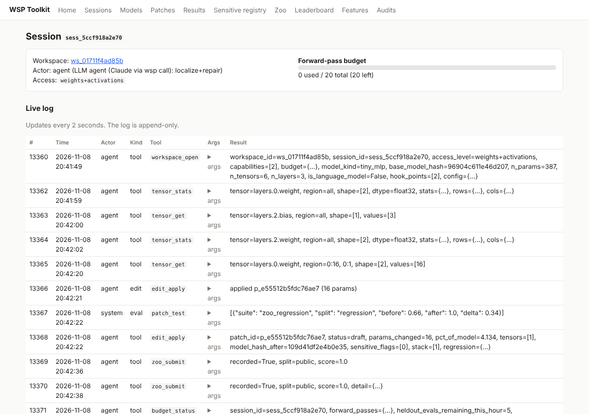

# WSP Toolkit

Tools that let AI agents, and the humans supervising them, do **weight-space programming**: read, diagnose,
edit and write neural-network weights directly, without gradient descent.

- **MCP server** (`wsp mcp`): 49 agent tools to inspect weights, probe activations and attention under a
  forward-pass budget, make reversible edits, run practice / held-out evaluations, work the network zoo, query
  the feature index and audit fine-tunes.
- **Web UI** (`wsp ui`): live session logs, model browser with heatmaps, patch review with approve/reject,
  evaluation results, sensitive-component registry, zoo leaderboard, feature browser and audit reports.
- **Local-first:** one machine, SQLite + safetensors, no cloud services. CPU is enough for everything except
  large models.

Built from `WSP_TOOLKIT_ROADMAP.md`, milestones M0–M7. **Read [`DECISIONS.md`](DECISIONS.md)** for every
assumption made without owner input, and [`docs/reports/milestones.md`](docs/reports/milestones.md) for the
acceptance results.



## Install

```bash
pip install --index-url https://download.pytorch.org/whl/cpu torch   # or your CUDA build
pip install -e '.[dev,hf,pdf]'
pytest                                                               # 64 tests (~2 min), CPU only, no network
```

Python ≥ 3.11. The `hf` extra adds Hugging Face models, `pdf` adds audit PDFs, and `bench` adds GSM8K/MATH
loaders.

## Quick start

```bash
wsp fixtures --out /tmp/fx      # train the CPU fixtures (~25 s) — also done automatically on first use
wsp ui                          # http://127.0.0.1:8765
wsp mcp --budget 50             # MCP server on stdio for Claude Code / Codex
```

Add it to Claude Code:

```bash
claude mcp add wsp -- wsp mcp --budget 50 --access weights+activations+outputs
```

Then ask the agent, for example: *"Open `fixture:induction_tf_broken`. Its copying behaviour is broken. Find out
why using the weight and probe tools, fix it with an edit, and check it on the practice suite."* Watch the
session in the UI, then approve or reject the patch.

You can also call tools from a shell with the same permissions an MCP agent has:

```bash
wsp call workspace_open '{"source": "fixture:induction_tf"}'
wsp call tensor_stats '{"session_id": "sess_…", "tensor": "blocks.1.attn.o_proj.weight"}'
```

## What's where

| Milestone | Code | Tools (see [`docs/tools/`](docs/tools/README.md), one page each with a real example) |
|---|---|---|
| M0 foundations | `config.py`, `core/db.py`, `fixtures/train.py` | append-only event log, config, deterministic fixtures |
| M1 inspect & probe | `core/workspace/`, `core/inspect/`, `core/probe/`, `core/directions.py` | `workspace_open`, `tensor_*`, `direction_*`, `run_forward`, `generate`, `probe_*`, `budget_status`, `result_page` |
| M2 patches | `core/edit/ops.py`, `core/patch/patches.py` | `edit_preview`, `edit_apply`, `patch_list/show/diff/revert/reapply/export` |
| M3 harness | `core/evals/` | `suite_list`, `suite_examples`, `suite_run_practice`, `evaluate_heldout`, `run_baseline`, `compare_runs`, `patch_test` |
| M4 safety | `core/safety/` | human-only approval, policy limits, sensitive registry, eval network guard |
| M5 zoo | `core/zoo/`, `agents/zoo_baseline.py` | `zoo_list_tasks`, `zoo_get_task`, `zoo_submit`, `zoo_scores` |
| M6 features | `core/features/` | `feature_search`, `features_at_location`, `neuron_features`, `features_active_on`, `feature_get`, `feature_neighbors` |
| M7 audit | `core/diff/`, `fixtures/finetunes.py` | `diff_models`, `diff_report`, `audit_get` |

Architecture: all logic is in `wsp_toolkit/core`. `core/service.py::Toolkit.call()` is the one entry point; it
enforces access and budgets, caps response size, and logs every call. `mcp_server/` and `api/` are thin wrappers
(MCP tool schemas are generated from the Toolkit's signatures).

## Key behaviours

- **Originals are never modified.** Edits go to an in-memory working copy rebuilt from a hash-verified
  read-only base plus a stack of patches. Every patch stores exact old/new values, so revert is bit-exact.
- **Budgets and access levels are first-class**: `weights_only`, `weights+activations`,
  `weights+activations+outputs`. The human sets the ceiling; agents can only ask for less.
- **Held-out data never reaches agents:** aggregate scores only, rate-limited, logged. Evaluation runs with
  network access blocked.
- **Human approval gates export**, and patches touching registered sensitive components need explicit
  acknowledgement.
- **Hard rule:** the toolkit refuses to open the calling agent's own weights (`agent_model`,
  `policy.forbidden_models`).

## Demos

```bash
wsp demo m1                 # scripted agent finds the induction heads (checked against ground truth)
wsp demo m3                 # scripted agent fixes a planted bug with a 50-pass budget, practice data only
wsp zoo build && wsp zoo baseline      # 392-network zoo + baseline scores
wsp features build          # SAE feature index on the induction fixture
wsp audit validate          # planted fine-tunes -> audit reports -> scored against ground truth
python scripts/qwen_m3_demo.py --confirm-download --device cuda --limit 50   # the real Qwen3.5 demo (GPU)
python scripts/gen_tool_docs.py   # regenerate docs/tools with live examples
```

## Docs

- [`DECISIONS.md`](DECISIONS.md): assumptions and decisions for review
- [`docs/reports/milestones.md`](docs/reports/milestones.md): acceptance results, honest caveats
- [`docs/tools/`](docs/tools/README.md): every tool: purpose, inputs, outputs, limits, example
- [`docs/configuration.md`](docs/configuration.md), [`docs/design/patch_semantics.md`](docs/design/patch_semantics.md),
  [`docs/design/graft_subspace.md`](docs/design/graft_subspace.md)
