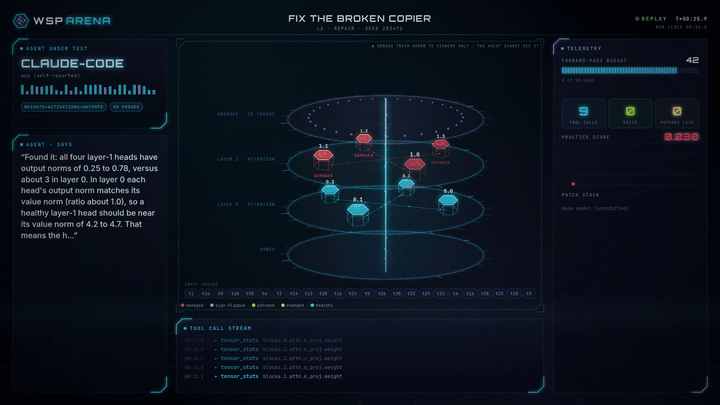

# Arena: watch (and record) an agent at work

The arena turns a challenge run into an animated, futuristic replay. It shows:

- the model under test, rendered as a 3D tower of attention heads (or as an MLP, or a grid of zoo networks);
- every tool call, as a laser scan, forward-pass wave, attention probe, surgery beam or rewind;
- the forward-pass budget draining, practice scores, the patch stack and the agent's own rationale;
- a score reveal at the end.

It works live while an agent runs, as a replay, as a single HTML file you can send to someone, and as an MP4 for
social posts.



Try it without installing anything: **https://encore488.github.io/weight-space-manipulator/arena.html**

## Watch live

```bash
wsp ui                                   # then open http://127.0.0.1:8765/arena
```

`/arena` follows the newest challenge run. If it is still in progress, the arena keeps polling and plays new moves
as they arrive. Other runs are listed in the selector and on the Challenges page (**▶ watch**).

Captions come from:

- `wsp agent run`: the model's text and thinking summaries, logged automatically;
- MCP agents (e.g. Claude Code): the optional, free `narrate` tool. Ask your agent to *"narrate what you're doing
  with the narrate tool"*;
- every edit's `rationale`.

## Record a video

**In the browser** (no extra installs): pick a frame size (16:9, 1:1, 4:5 or 9:16) and press **● Rec**. The run
plays from the start, records in real time and downloads a WebM (or MP4 where the browser supports it) when it ends.

**Frame-exact MP4** (recommended for posts; every frame is rendered, never dropped):

```bash
pip install "wsp-toolkit[video]"         # Playwright + an ffmpeg binary
playwright install chromium              # once (~150 MB)
wsp arena list                           # recent run ids
wsp arena record latest --size portrait  # 1080x1350, the best fit for a LinkedIn/Instagram feed
wsp arena record cr_1234abcd --size landscape --out demo.mp4
```

Sizes: `landscape` (1920x1080), `square` (1080x1080), `portrait` (1080x1350), `vertical` (1080x1920) or any `WxH`.
`--crf` sets the H.264 quality (18 by default; lower means better and bigger). A one-minute replay takes a few
minutes to render on a laptop CPU.

**Share an HTML file**: `wsp arena export latest --out run.html` writes one self-contained file (renderer, fonts
and data inlined) that plays in any browser. Press space to play or pause, and ←/→ to seek.

## Reading the screen

| Element | Meaning |
|---|---|
| Red heads | damaged (shrunk output) in the hidden ground truth |
| Magenta heads | sign-flipped in the hidden ground truth |
| Green heads | an applied patch targets a damaged head with an operation that could fix it |
| Amber | changed by a patch, but not a damaged head (or the edit can't fix that kind of damage) |
| Violet / sky heads (induction hunt) | true induction / previous-token heads |
| Laser sweep | weight inspection (`tensor_stats`, `tensor_svd`, …) on the highlighted component |
| Wave up the residual beam | forward passes (the budget bar burns down) |
| Arcs over the tokens | an attention probe (the ideal induction pattern is drawn; the log doesn't store attention values) |
| Surgery beams + "PATCH APPLIED" | `edit_apply`, with the automatic regression check (before → after) |
| Rewind | `patch_revert` (bit-exact) |

Viewers see the ground truth; the agent never does. Real time is compressed (each step gets a fixed on-screen
duration). The *run clock* in the header shows how long the agent actually took. Scores, budgets, edits and
rationales are real data from the append-only event log.

## Under the hood

`wsp_toolkit/core/arena.py` builds a JSON timeline of "beats" from the event log (`wsp arena timeline` prints it).
`wsp_toolkit/ui/static/arena.js` renders frame `t` as a pure function of the timeline, so playback, scrubbing and
recording are deterministic. The website's replays are timeline files in `leaderboard/replays/`.
